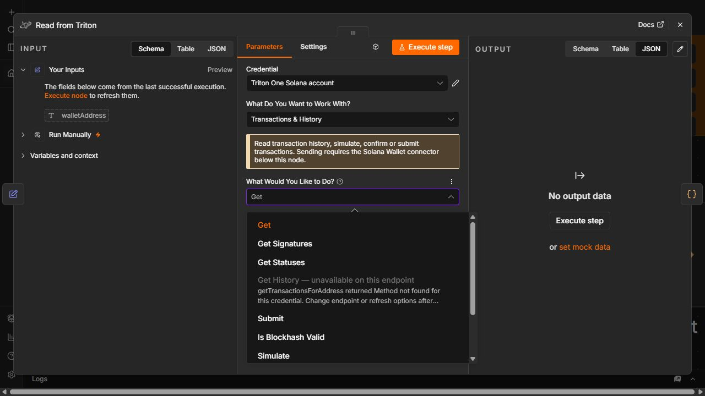
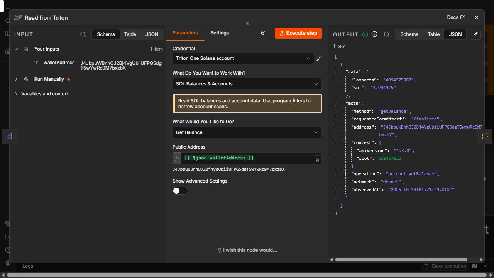

# Devnet acceptance — 13 October 2026

Latest bounded live read suite: **39/45 passed**. No Mainnet calls, signing or broadcasting in this suite. Empty-result responses validate request acceptance, not populated-data semantics.

## Confirmed unavailable on the saved endpoint

- Enhanced address history and address-history export: getTransactionsForAddress returns -32601 Method not found.
- Token accounts by mint: getTokenAccountsByMint returns -32601.
- These three choices are disabled dynamically only when the selected credential confirms the method is absent. Capability probes use empty parameters and cache results for 60 seconds per endpoint/token/method. Invalid parameters, index errors, auth errors, timeouts and HTTP 503 do not disable choices. An explicit HTTP 410 disabled-method response also counts as unavailable.
- Titan is disabled for non-Mainnet credentials because the implemented quote/swap path requires Mainnet. This is a network restriction, not proof Titan is broken. No live Titan quote or swap was completed.

## Failures left enabled

Delegate queries with SPL and Token-2022 program filters returned -32010 (missing secondary index). The mint-filter query timed out; it is NOT confirmed unsupported. Bundle simulation previously returned HTTP 503. These do not justify disabling whole service groups.

## Fixed and verified

Block export originally failed with -32015 on version 1 transactions. Read/stream request configuration now permits version 1; the live block export passed afterward. Read response tests preserve transactionConfig. This does not add version 1 wallet signing support.

Full offline runner passed build, typecheck, lint, **150 node tests**, **11 worker tests**, local gRPC, a 5,000-event worker test and actual n8n execution-context checks. Previous live evidence includes Whirligig account/slot monitoring, Dragon slot updates, worker persistence/ack/restart and Account Sync RPC fallback. The dedicated Account Sync push method returned HTTP 501 and remains degraded, not a proven live push feed.

## Still unverified

Titan live quotes/swaps, specialized Deshred/Vixen/Fumarole feeds, Cascade/Shield delivery, management APIs, compressed-asset proofs with a valid fixture, dedicated Account Sync push, Docker/Linux/queue deployment and sustained production load. These remain explicit coverage gaps; missing access or fixtures does not mean broken. The optional test worker is stopped after acceptance testing.

## Latest live checks

| Operation | Result | Evidence |
| --- | --- | --- |
| account.get | PASS | Valid response |
| account.getMany | PASS | Valid response |
| account.getByProgram | PASS | Valid response |
| account.getRentExemption | PASS | Valid response |
| token.getByOwner | PASS | Valid response |
| token.getByOwner | PASS | Valid response |
| token.getByDelegate | FAIL | RPC -32010 |
| token.getByDelegate | FAIL | RPC -32010 |
| token.getByDelegate | FAIL | Timeout/transport failure |
| token.getLargestAccounts | PASS | Valid response |
| token.getBalance | PASS | Valid response |
| token.getByMint | FAIL | RPC -32601 |
| transaction.getStatuses | PASS | Valid response |
| transaction.getHistory | FAIL | RPC -32601 |
| transaction.isBlockhashValid | PASS | Valid response |
| network.getPerformanceSamples | PASS | Valid response |
| network.getTransactionCount | PASS | Valid response |
| network.getSupply | PASS | Valid response |
| network.getVoteAccounts | PASS | Valid response |
| network.getClusterNodes | PASS | Valid response |
| network.getEpochSchedule | PASS | Valid response |
| network.getLeaderSchedule | PASS | Valid response |
| network.getSlotLeader | PASS | Valid response |
| network.getSlotLeaders | PASS | Valid response |
| network.getFirstAvailableBlock | PASS | Valid response |
| network.getMinimumLedgerSlot | PASS | Valid response |
| network.getInflationRate | PASS | Valid response |
| network.getInflationGovernor | PASS | Valid response |
| network.getInflationReward | PASS | Valid response |
| block.get | PASS | Valid response |
| block.getTime | PASS | Valid response |
| block.getRange | PASS | Valid response |
| block.getWithLimit | PASS | Valid response |
| block.getCommitment | PASS | Valid response |
| block.getProduction | PASS | Valid response |
| fee.getRecentPriorityFees | PASS | Valid response |
| digitalAsset.getByOwner | PASS | Valid response |
| digitalAsset.search | PASS | Valid response |
| digitalAsset.getTokenAccounts | PASS | Valid response |
| digitalAsset.getByAuthority | PASS | Valid response |
| digitalAsset.getByCreator | PASS | Valid response |
| digitalAsset.get | PASS | Valid response |
| digitalAsset.getMany | PASS | Valid response |
| archive.exportAddressHistory | FAIL | RPC -32601 |
| archive.exportBlocks | PASS | Valid response |

## Editor verification

n8n restarted with the tested build. The actual editor shows History, Token Accounts by Mint and Address History Export disabled for the saved Devnet credential; Titan shows Mainnet required. Export Blocks, delegate queries and bundle simulation remain selectable. After restoring the balance template, a fresh editor execution passed with 4.994975 devnet SOL at finalized slot 510457823. UI verification briefly produced an expression-entry error; the restored expression and subsequent execution both passed.

