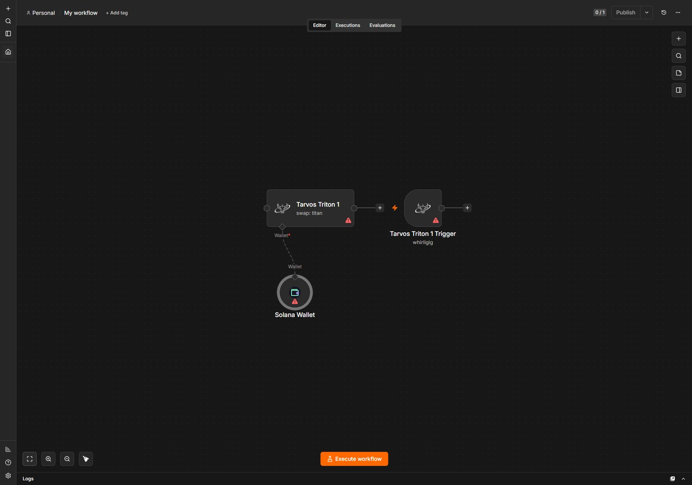
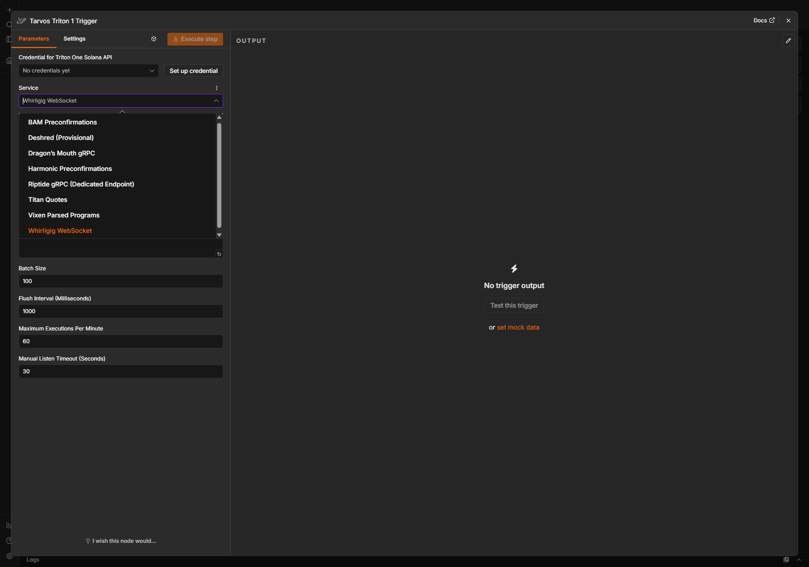

# Validation and release gates

Latest: [Devnet acceptance and credential-aware disabled choices](DEVNET-ACCEPTANCE.md). Historical sections below retain their original counts and limitations.

Local development evidence, 13 October 2026, version 0.2.0. This is a self-hosted evaluation build, not a published production release.

## Restart and live worker acceptance: 13 October 2026

Restarted the local n8n server on loopback port 5682; new process 39360 became ready and `/healthz/readiness` returned 200. The monitoring metadata fix is now available to the restarted server.

Live Account Sync testing found and repaired SDK hydration authentication (internal fetches omitted configured HTTP headers) and unsafe numeric rent-epoch output. The SDK receives a token-authenticated runtime URL without changing saved clean endpoints. Unsafe account numbers now select a full, losslessly parsed RPC account read, preserving the exact u64 rent epoch `18446744073709551615`. Both SDK and exact-fallback responses must satisfy the requested slot freshness. Unknown accounts are rejected before querying.

The provider returned HTTP 501 for the dedicated Account Sync gRPC method. Reads of the funded Devnet wallet and clock account pass through explicitly labelled RPC fallback with `transportDegraded: true`. Ordinary Dragon's Mouth gRPC remains functional. No claim of cached/push Account Sync delivery is made.

Live worker acceptance passed: Whirligig clock and Dragon slot ingestion into SQLite, authentication rejection, exact account/freshness checks, unconfigured-address rejection, independent consumers, stable receipt redelivery, invalid receipt rejection without advancement, process restart before acknowledgement, idempotent acknowledgement and consumer isolation. Actual n8n workflows 11 and 12 passed all four worker operations (status, account, events, acknowledgement) and verified five events. No transactions were signed or broadcast.

Full offline checks passed with 145 node tests and 9 worker tests; the final additional authentication/freshness regressions and all worker tests then passed (11 worker tests), followed by another successful live acceptance run. Evidence: `test-results/worker-final-offline.log`, `worker-regression-final.log`, `worker-live-acceptance.json`, `account-sync-probe.json`, `account-sync-transport.json`, `n8n-worker-execution.log`. The test worker was stopped after testing; n8n remains running. Local launcher: a machine-local launcher (not included; use worker/README.md). It loads only the named encrypted Devnet RPC/worker credentials. No keys are embedded in the launcher or portable workflow.

Remaining provider-dependent gates are unchanged: dedicated Account Sync push endpoint, Fumarole, specialized feeds, Titan sandbox, bundle service, Cascade/Shield and management access. Docker/Linux/queue-mode deployment remains unverified. These are not covered by the passing local worker tests.

## Additional Devnet service checks: 13 October 2026

User explicitly restricted further work to Devnet. Live compiled transports received Whirligig slot/account events and Dragon's Mouth gRPC slot events using the existing credential. A DAS owner query returned a valid result (this does not prove asset/proof/index fixtures). Ordinary simulation of a valid unsigned transfer succeeded; simulateBundle with that valid fixture returned HTTP/RPC 503. Titan GetInfo through the Devnet endpoint failed with TITAN_CONNECTION; no live Titan quote/swap success is claimed. No signing or broadcasting occurred in these additional checks.

Actual n8n monitoring workflow `TarvosMonitor01`, execution 10, completed with four confirmed clock-account events. Portable template: `examples/monitoring/devnet-live-account.json`. It remains unpublished and stops after a manual batch.

Fixed gRPC event classification to skip null/undefined protobuf oneof members. Without this, a slot update can be mislabeled as an account event and lose its top-level slot. The rebuilt transport passed a live slot-kind/slot-number assertion and a regression test. A fresh full offline run passed 145 node tests, 7 worker tests, build/lint/typecheck, local gRPC, worker load and n8n runtime checks. The running n8n server may retain the previous gRPC module until its next restart; the live regression used the rebuilt module in a fresh process. Whirligig behavior is unchanged.

Evidence: `test-results/remaining-services.json`, `test-results/devnet-bundle-check.json`, `test-results/monitor-n8n.json`, `test-results/remaining-offline.log`. Remaining specialized feeds, Account Sync/worker live integration, management, Cascade/Shield and Titan require their own acceptance checks. [Current Devnet-only access checklist](LIVE-TEST-SETUP.md).

## Manual rerun repair and five basic templates: 13 October 2026

The original manual execution 2 reported a false failure: its transaction finalized, but the test compared the recipient's cumulative balance against exactly 0.001 SOL. After repeated transfers that comparison is invalid. The repaired workflow fetches the submitted transaction and checks its signature, successful metadata, fee cap and recipient post-minus-pre balance against the intended amount. Regression coverage includes repeated runs, wrong credit, failed transactions and excessive fees.

Actual n8n CLI executions 3–6 passed the four read-only [basic templates](../examples/basic/README.md): wallet balance, recent wallet activity, token supply and transaction inspection. Two actual editor-triggered executions, 7 and 8, passed the repaired transfer. Each sent 0.001 devnet SOL, finalized, credited exactly 1,000,000 lamports and paid 5,000 lamports in fees. Transaction identifiers are omitted from the public report.

The saved credential targets the assigned Devnet rpcpool.com endpoint. Six additional authenticated read checks (genesis hash, health, version, slot, epoch information and recent prioritization fees) returned HTTP 200 with valid RPC results; genesis matched Devnet. No public-RPC fallback was used. Sanitized evidence: local `test-results/basic-live-validation.json`. This proves the configured endpoint responds; dashboard aggregation, reporting delay and billing visibility were not independently verified.

Fresh complete offline run: **144 node tests and 7 worker tests pass**, with build, typecheck, lint, local gRPC, 5,000-event worker checks and actual n8n execution-context checks. These results do not establish live Titan swaps, streaming, DAS, Cascade, management APIs, Linux or queue deployment. The historical sections below describe earlier runs and retain their original limitations.

## Authenticated Triton and saved n8n wallet: 13 October 2026

Created encrypted `Solana Devnet Test` credential and an inactive manual workflow, `Triton - Devnet Wallet Acceptance` (local-only ID omitted). Real n8n CLI execution uses the existing `Triton One Solana account` credential, reads sender balance and a fresh blockhash, constructs a 0.001 devnet SOL transfer, enforces a 10,000-lamport network-fee ceiling, resolves the attached Solana Wallet from encrypted storage, simulates the signed transaction, submits once and checks confirmation and exact recipient balance. All stages passed; the transaction finalized with a 5,000-lamport fee. No mock/public endpoint adapter was used.

Transaction identifier omitted. Evidence: `test-results/n8n-devnet-acceptance.json` and the saved n8n execution. The wallet private key was never printed or placed in workflow parameters. The import artifact was encrypted using the local n8n instance key. This validates authenticated standard Triton devnet RPC and wallet submission, not Titan mainnet swaps or other service entitlements. The existing monitoring workflow was not modified.

## Funded devnet validation: 13 October 2026

The dedicated test wallet received 5 devnet SOL. The compiled node and wallet capability passed network identity, signed preflight simulation, one 0.001 devnet SOL submission, finalized confirmation and exact recipient balance verification through the public-RPC test adapter. A separate read of the finalized transaction confirms success, a 5,000-lamport fee, slot 510445601, and remaining sender balance of 4.998995 devnet SOL.

The finalized transaction was verified during the local test. Evidence: local `test-results/devnet.json`, timestamped run report and `test-results/devnet-finalized.json`. No retry or second submission occurred. This proves the public-devnet standard transaction path, not authenticated Triton/Cascade delivery, live n8n editor execution or a Titan swap. Mainnet submission remains unperformed.

## Swap enforcement update: 13 October 2026

Actual Titan V2 instruction bytes now enforce the input amount and minimum-output floor before signing. Fixed wallet/mint/ATA bindings, supported setup/cleanup instructions, zero provider/service fees, standard SPL mint ownership and a 100,000-lamport network fee ceiling are checked. Unsupported versions, Token-2022 and unfamiliar instructions are rejected. Requests use numeric V0 format and explicitly select router V2. [Scope and trust boundaries](SWAP-SAFETY.md).

The complete offline suite passes: **141 node tests, 7 worker tests**, build, lint, typecheck, local gRPC and actual n8n runtime checks. Adversarial end-to-end tests show tampered route bytes never reach wallet preparation. A 5,000-event SQLite burst test separately passed capacity, two-consumer delivery, replay, duplicate acknowledgement and pruning assertions (about 2.5 seconds locally; sampled process RSS about 71 MB). This is not a production throughput guarantee.

Runtime dependency audits completed: root reports 4 moderate affected packages and worker reports 5, with zero high/critical in both. These include transitive uuid/stream-json findings through web3.js/jayson. The suggested root remediation is a breaking web3.js major change; the worker has no npm-proposed fix. No forced upgrade was applied, and this is not a security-clearance claim.

Docker engine startup timed out; container/Linux/queue-mode execution remains unverified. The new `test:titan-simulation` runner explicitly returns BLOCKED with missing access, and never signs or broadcasts. No provider or funded mainnet tests were performed. [Exact live setup](LIVE-TEST-SETUP.md).

## Latest audit: 13 October 2026

The example baseline is repaired: all 13 workflows are generator-owned and include the required pinData. The complete offline runner passes build, generation, typecheck, lint, 134 node tests, gRPC loopback, 7 worker tests, and actual n8n 2.32.6 execution-context/HTTP checks. An additional public-adapter regression test subsequently passes (135 total node tests after addition). Worker evidence now includes actual child-process termination at insert, receipt and acknowledgement boundaries.

Public devnet smoke: 10 checks passed, including exact balance comparison. Mainnet negative simulation passed with the expected unfunded-payer rejection. The devnet faucet returned RPC_ERROR, so no transaction was sent; this run recorded FAIL for the funding call and BLOCKED for submission. Subsequent harness handling classifies faucet rejection as BLOCKED and supports an existing dedicated devnet key file; this fallback has not been exercised live. No faucet retry was made.

Triton credentials are absent. Provider acceptance and positive Titan swap simulation remain BLOCKED. No mainnet submission occurred. Reports are in local `test-results/`; the reproducible workflow is in [Developer testing](DEVELOPER-TESTING.md). These public checks do not establish Triton acceptance. Original [research](TESTING-RESEARCH.md), [matrix](TEST-MATRIX.md), and failing baseline (machine-local historical log, not distributed) remain historical evidence.

## Previously completed

- Quick Setup: five confirmed subscription presets, version compatibility, and RPC credential/service selection are tested. New node version 1.2 uses Quick Setup; older nodes retain their saved advanced setup.

- Guided-input update: request-shape tests cover field-based Whirligig subscriptions, program filters, transaction filters, gRPC/deshred, preconfirmation regions, query options, address lists and legacy JSON mode. Build and lint pass. Node version 1 keeps JSON defaults; version 1.1 defaults to Fields.

- Official n8n node CLI build, TypeScript typecheck and ESLint pass on Windows.
- **133 node tests pass**: original serializers and signing behavior, expanded RPC/DAS request fixtures, Titan binary protocol and instruction signing, Cascade, bundle simulation, archives, administration redaction, streaming and trigger lifecycle.
- **4 optional-worker tests pass**: SQLite persistence across restart, explicit/idempotent acknowledgement, independent consumers, authenticated HTTP and Fumarole recovery-boundary behavior.
- Real local gRPC server tests pass for Subscribe and SubscribeDeshred using the official pinned codecs without loading the unavailable Windows Yellowstone native binding.
- Actual n8n 2.32.6 execution-engine checks pass: wallet attachment and supplyData capability, Titan/Cascade wallet ports, per-item expressions, signed-payload validation, workflow connection round trip and read isolation.
- Actual n8n HTTP helper retains unsafe integer JSON as raw text through lossless parsing.
- Clean production installation from the 0.2.0 package archive succeeds; all three registered node modules and Yellowstone codecs load. Final packaging adds documentation and trigger documentation metadata to that tested build.
- Local editor loads all three nodes, all service groups and eight trigger choices. Titan Swap has the bottom wallet connector; Solana Wallet contains public address, network, signing mode and credentials. The official TARVOS logo appears on the action and trigger nodes.
- Thirteen inactive example workflows are included. The local preview is an unexecuted draft, with blank credentials/transaction inputs. Red warning indicators are expected.
- No authenticated provider calls or transaction broadcasts occurred. Public Solana reads and negative mainnet simulation were run in the latest audit. Protocol fixtures and local transports do not prove acceptance by a particular customer endpoint.

## Still required before production release

| Gate | Status |
| --- | --- |
| Live service acceptance | Validate RPC/DAS, Titan, Cascade, bundle simulation, streams and management with the intended customer endpoints and entitlements. |
| Transaction delivery | Standard authenticated Triton devnet submission finalized in CLI and repeated manual n8n runs. Cascade delivery and separately approved mainnet Titan swaps remain unverified. |
| Worker deployment | Persistence/HTTP tests pass locally. Real Fumarole retention/replay and Account Sync behavior need customer endpoints. Docker recipe has not been built in this session. |
| Queue mode and load | Real manual execution context tested; deployed queue-mode, sustained traffic, memory and execution-volume benchmarks remain. |
| Linux environment | CI configured, but no remote Linux CI run occurred in this session. |
| Dependency security | No security-clearance claim. Review the current root and separate worker dependency audits and upstream advisories before deployment; previous-version audit counts are not evidence for this release. |
| n8n Cloud | Targets self-hosted n8n and ships dependencies; no Cloud approval claim. |
| Publication | No npm publication, GitHub release or live website update. |

## Material limits

See [implemented services](SERVICES.md) and [worker deployment](../worker/README.md) for exact contracts and exclusions.

Titan swaps support ExactIn instruction routes with one signing wallet, validated lookup tables, required simulation and bounded expiry. Opaque transaction-only routes and additional signers are rejected. Provider instructions still determine DEX program behavior.

Direct streams are best-effort: reconnection is not replay. Fumarole uses a fixed source replay boundary because the pinned SDK does not expose an explicit commit-after-persistence API. It stops when recovery falls outside retention; it is not an indefinite unattended checkpointing solution. Account Sync freshness is measured in slots, not guaranteed wall-clock age.

The wallet uses n8n's ai_tool connection type internally because there is no native Wallet port. Generic tool chrome remains, but it is not an agent-invocable signing tool. No wallet secrets enter the optional worker.

HTTP response parsing limits apply after buffering. Archive bounds, event batches and execution budgets limit individual operations, not total deployment throughput. No exactly-once monitoring, instant finality, guaranteed delivery or provider availability promise is made.

Guided trade checks cover exact large-amount conversion, precision and overflow rejection, on-chain decimal resolution, percent-to-basis-point conversion, legacy version preservation, and connected-wallet quotes never signing or submitting. Public-address-only wallets reject transaction preparation and swaps. Provider access and actual mainnet execution were not tested.
